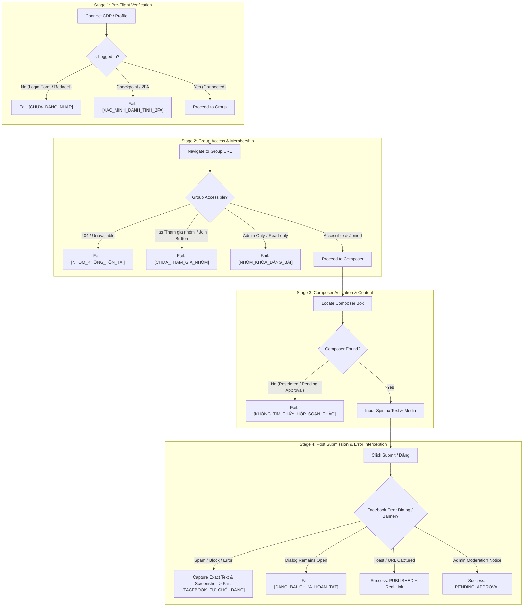

# Implementation Plan: Facebook Login Verification & In-Flight Error Tracking

**Goal:** Establish rigorous, fail-closed verification of Facebook account login status, multi-stage in-flight posting checks, and comprehensive error reporting with exact page content and screenshots.

---

## Architecture & Verification Pipeline

---

## User Review Required

> [!IMPORTANT]
> - Hệ thống sẽ áp dụng nguyên tắc **Fail-Closed**: Không bao giờ giả định một tài khoản đang `CONNECTED` chỉ vì có thư mục trên ổ cứng.
> - Bổ sung nút **[🔍 Kiểm tra đăng nhập]** để AM chủ động thăm dò phiên đăng nhập thực tế của nick trước khi bấm đăng bài.
> - Bất kỳ lỗi nào trong quá trình chạy sẽ trích xuất nguyên văn câu thông báo của Facebook, chụp ảnh màn hình lỗi, và hiển thị rõ ràng trên giao diện kèm hướng dẫn xử lý.

---

## Proposed Changes

### 1. `packages/browser-automation/src/publishers/facebook-group-publisher.ts`
- Enhance `publishToFacebookGroup` with multi-stage checks:
  1. Detect login forms (`input[name='email']`, `input[name='pass']`, `button:has-text('Đăng nhập')`).
  2. Detect checkpoint / suspension (`/checkpoint`, `/recover`, "Xác nhận danh tính").
  3. Detect group unjoined state (`Tham gia nhóm`, `Join group`).
  4. Detect group admin restriction.
  5. Check for Facebook error modal / alert banners after clicking submit.
  6. Check if dialog failed to close (fail-closed).
  7. Capture screenshot proof on error as `proof-error-${jobId}.png`.
- Export `verifyFacebookSession(options: { accountId: string; storageRootDir?: string })` to probe session without posting.

### 2. `packages/browser-automation/test/facebook-group-publisher.test.ts`
- Unit tests for:
  - Detecting login form prompt on group page -> throws `[CHƯA_ĐĂNG_NHẬP]`.
  - Detecting "Tham gia nhóm" -> throws `[CHƯA_THAM_GIA_NHÓM]`.
  - Detecting Facebook spam error toast/modal -> throws `[FACEBOOK_TỪ_CHỐI_ĐĂNG]`.
  - Verifying session helper returns `NEEDS_LOGIN` vs `CONNECTED`.

### 3. `apps/web/src/server/operations-hub.ts`
- Update `verifyAccountSession(workspaceId, accountId, platform)`.
- Update `executeGroupPostingJob` to handle structured errors, save error screenshot URL, and update account status if unauthenticated.

### 4. `apps/web/src/server/http-api.ts`
- Expose endpoint `POST /api/v1/social-accounts/:accountId/verify-session`.

### 5. `apps/web/src/ui/facebook-auto-poster-view.tsx`
- Add button **[🔍 Kiểm tra đăng nhập]** in account toolbar.
- Render error alert box with error code, message, and link to error screenshot modal.
- Prevent dispatch if account status is `NEEDS_LOGIN`.

---

## Verification Plan

### Automated Tests
1. `corepack pnpm vitest run packages/browser-automation/test/facebook-group-publisher.test.ts`
2. `corepack pnpm vitest run apps/web/test/group-posting-operations.test.ts`
3. `corepack pnpm vitest run apps/web/test/facebook-auto-poster-view.test.ts`
4. `corepack pnpm typecheck`

### Manual Verification
1. Access `http://127.0.0.1:3000` -> Click **[🔍 Kiểm tra đăng nhập]**.
2. If account is not logged in, status updates to `NEEDS_LOGIN` with yellow/red badge.
3. If trying to post with unauthenticated account, error is recorded with `[CHƯA_ĐĂNG_NHẬP]` and displayed in table with retry option.
